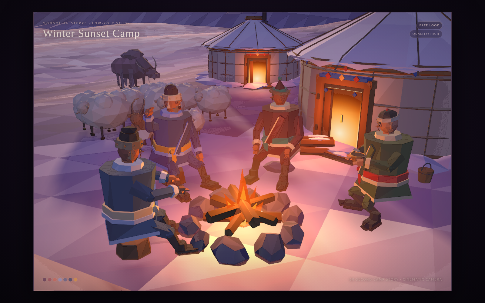

# Winter Sunset Camp

A single-scene Three.js interpretation of the **Mongolian Steppe Low-Poly** style guide. It follows the guide's "perfect middle" recipe: faceted terrain and mountains with clean, readable subjects, under a winter-sunset palette.



## Run it

For development, use Node.js 24 and npm. If you use nvm, `nvm install` and
`nvm use` read the version from `.nvmrc`. Then run:

```bash
npm ci
npm run dev
```

Open [http://127.0.0.1:4173](http://127.0.0.1:4173). Edits to `src/` or
`template.html` reload the browser automatically. Stop the server with Ctrl+C.
The server is local to your computer; if port 4173 is already in use, stop the
other server or use `npm run dev -- --port 4174`.

To view or share the finished scene, run `npm run build` and open `index.html`
directly in a browser. It works from disk with no server or internet connection.
You can also share the identical `winter-sunset-camp.html` file by itself.

- Plays the cinematic shot director by default
- **Free look** disables the director and lets you drag/zoom the camp
- **Quality: High** toggles the post stack off for lower-end GPUs

The frame is locked to the guide's 3:2 aspect ratio.

## What's in the scene

- **Faceted snow terrain** with per-face value and hue variation, irregular triangulation, a raised foreground drift, and tinted shadows
- **Layered mountain ranges** built as broad, jagged heightfield ridges, led by a large left massif with snow and rock streaks, with the distant ranges dropped into warm haze
- **Three gers** with a scalloped snow cap, wall-base drifts, horizontal rope bands plus vertical wall ropes, flush roof ropes, a toono crown ring, a capped stovepipe, wall-top diamond trim, ornamented doors, and smoke
- **Four expressive herders seated around the fire** — eye whites, pupils, catchlights, individual brows, noses, lips, mustaches/beards, and an earring; fingers on articulated hands; fur, peaked, and rounded Mongolian hats; broad coat bodies; high collars and fur ruffs; diagonal deel wraps, bright sashes with tails, flared cuffs, and upturned boots
- **60-second camp story** — five seconds of fireside talk, then the gray-bearded elder performs a slow front-of-fire loop with a raised hand; the listener mounts the horse and rides a circuit; the tea-holder enters the main ger (the door leaf and doorway light animate) and returns; and the fire keeper hauls a log in, stokes the fire, and settles. Everyone returns to the fire before the cycle loops
- **Living idle layer** — the four herders breathe, blink, sway, turn their heads, and move their mouths or hands independently; the horse walks with a diagonal gait and flicks its ears and tail; sheep graze and flick ears/tails with a lamb hop; the goat shifts and flicks; the yak chews and swishes its tail
- **Motion pass** — speed-matched gait with hip, knee and ankle pivots plus toe-off; body sway, chest twist and head counter-rotation; eased starts/stops, smooth turns and sash secondary motion; the wood run and yurt return are rescheduled and walkers actively separate so routes no longer clip through each other. The rider's mount/dismount tucks the legs and seats him astride
- **Animation pipeline pass** — fixed-step 60 Hz simulation with dt-based damping; distance-driven stride with world-space stance-foot anchors, swing arcs and two-bone leg IK; a generated speech pulse track driving mouth, brows, nods and beat gestures with listener reactions; gaze targets, eye saccades and randomized double blinks; an eight-shot camera director covering the establishing wide, fireside conversation, performance, rider, snow wide, yurt door and ending wide; and a post stack with bloom, grade, vignette, light grain and FXAA. Cinematic/free and high/low quality are live toggles
- **Herd**: a lofted chestnut horse with mane, forelock, saddle, stirrups, and a lead rope; a humped, shaggy yak; a lean horned/bearded goat; and a flock of sheep (including a dark-faced one and a lamb)
- **Camp details**: woodpile with axe and stump, bucket, hitching post, stumps/stone seats, grass tufts, rocks, rope fence, and banner poles
- **Warm accents**: a localized campfire glow and flickering warm point light, doorway light pools, and a low sunset glow
- **Atmosphere**: layered faceted cloud banks, drifting smoke, gently falling snow, and a V of geese

Lighting uses a warm low sun, a warm rim light, a cool frontal fill, and a small emissive floor on the figures so shadow sides read lavender instead of black. Contact shadows sit under the people and animals; the static props keep their baked long shadows, while the moving herders, horse, and rider refresh the shadow map during the active part of the story.

The files also implement the follow-up `winter_camp_3d_upgrade_spec.md`: rebuilt people and animals, yurt detail pass, character lighting, and terrain/foreground polish. The final composition, scale, palette, and cloud deck are matched to the winter-sunset reference plates. A dedicated herder pass adds expressive faces and hands, the 60-second story adds curved eased paths, mount/dismount behavior, a yurt visit, and an animated horse, flock, goat, and yak, and the motion pass adds grounded feet, secondary motion, smooth facing and active walker separation. The shadow map refreshes only while the camp is moving.

## Files

| File | Use |
|---|---|
| `index.html` | Self-contained scene — all JavaScript is inlined; load this |
| `winter-sunset-camp.html` | Fresh-launch copy of `index.html` (same self-contained build) |
| `template.html` | UI/CSS shell used to generate the two HTML builds |
| `bundle.js` | Built scene script (also inlined into `index.html`) |
| `src/main.js` | Readable scene source |
| `dev.html` | Generated ES-module page for a basic static server; prefer `npm run dev` while editing |
| `vendor/` | Three.js r160 and OrbitControls used by the source |
| `package.json` / `package-lock.json` | Runtime dependencies and pinned development tools |
| `vite.config.js` | Local server, automatic reload, and shared Three.js resolution |
| `scripts/build.mjs` | Node.js build for the main scene and character-detail variant |
| `scripts/*.test.mjs` | Build and development-server regression checks using Node's built-in test runner |
| `build.sh` / `build-test.sh` | Compatibility shortcuts for the npm build commands |

## Edit and rebuild

Edit `src/main.js` for the scene, `src/herder.js` for the characters, and
`template.html` for the page and styles. The development server reads these
sources directly, so you do not need to rebuild after each edit.

| Command | Use |
|---|---|
| `npm run dev` or `npm start` | Start the development server with reload and readable source maps |
| `npm run build` | Export the main scene as self-contained HTML |
| `npm run build:test` | Export the separate character-detail scene to `test-style.html` |
| `npm test` | Check HTML exports, inline script safety, detail-build isolation, and development module resolution |
| `npm run check` | Run the regression check and compile both scene variants |

Before sharing a change, run:

```bash
npm run check
```

The build writes `bundle.js`, `index.html`, `winter-sunset-camp.html`, and
`dev.html` in the project folder. These are generated files; edit the source
instead. `build:test` writes only `bundle-test.js` and `test-style.html`.
The final HTML has no runtime dependency on `node_modules`. The detail variant
is a separate older scene in `src/main-test.js`, not an automated visual test;
preview it at `/test-style.html` on the development server.

`npm ci` installs exactly the versions in the lockfile. After an intentional
dependency change, use `npm install` and keep the updated lockfile. Internet is
needed to install dependencies; builds use the installed local tools.

No `.env` file, API keys, Python, or global build tools are needed. `.editorconfig`
defines indentation and line endings for editors that support it. Environment
files, dependency folders, and logs are excluded by `.gitignore`; the HTML
exports remain eligible for version control. This folder does not yet have a
Git repository; `.gitignore` takes effect if you initialize one.

The automated checks cover build behavior and JavaScript compilation. They do
not validate WebGL rendering or the full animation visually; open the scene in
a browser after scene changes.

## Palette notes

The reference pass uses a violet-to-coral sky (`#4b3567 → #b2637a → #ff9b78`), rose and mauve cloud banks (`#6f3b55` with `#d58a80` lit edges), lavender snow (`#efe2e9 / #b8a7cf / #7b6f9f`), a dark violet left massif with bright snow (`#897da8` / `#fbf8ff`), hazed far ranges (`#a79ac7` / `#b9aed3`), warm door and fire light (`#ffb05a / #f08473`), and a localized orange fire pool (`#ff9a3c`).
