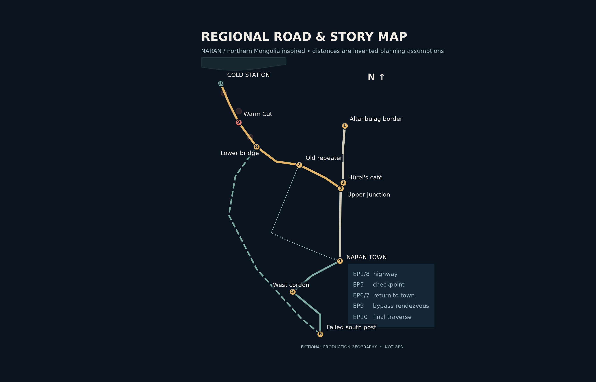
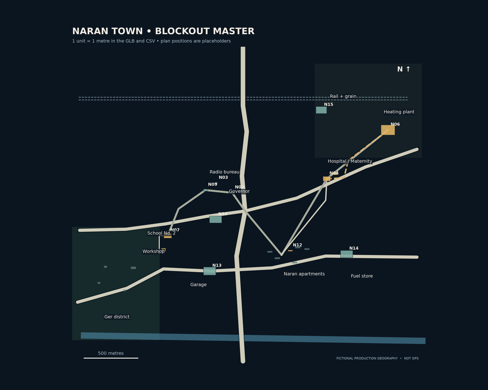
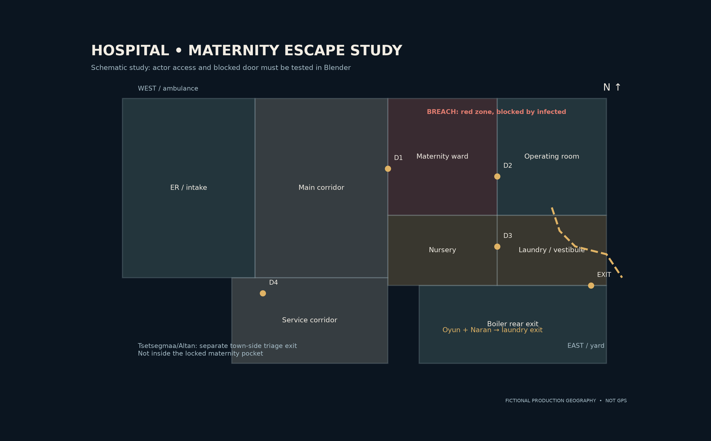

# ХАНИАД / THE COUGH
# NARAN WORLD BIBLE — v1.0

**ART DEPARTMENT + LEVEL DESIGN + STORY CONTINUITY / PRODUCTION MASTER**  
**World:** Naran (Наран), fictional northern-Mongolian town, late November 1998  
**Season:** 10 episodes × target 8–10 minutes  
**Design state:** **GRAYBOX / ART-DIRECTION PROPOSAL** — not final approved screen canon  
**Primary story source:** `khaniad-season1-v3-ten-episode-story-bible.md` (10-episode treatment). Episode 1 derives from `khaniad-act1-v2.1-production-direction.md`.  
**Scope:** Naran geography, settlement, key sets, road logic, style, asset system, continuity, sound, set-testing requirements.

> **The promise of the world:** Naran is not an anonymous post-apocalyptic wasteland. It is a small, inhabited town that has spent decades building a normal life around heat, roads, the railway, school, food, paperwork and neighbors. Horror occurs when these perfectly ordinary systems become traps. Warmth keeps people alive — and attracts the infected. A locked door saves someone — and condemns someone else.

## READ FIRST — Status and source hierarchy

**LOCKED STORY (L):** Ganaa's EP1 border/café/birthday chain; the bite (not shared tea) transmits infection; the original strong Mongolian dialogue stays; the future retrieval of the undelivered satchel; ten connected episodes; 1998; human, darkly funny horror; no magical ambulance fuel or instant cures.  
**PRODUCTION PROPOSAL (P):** the town footprint; the road lengths, elevations, building sizes, exact positions, district names, map colors and floorplan. These solve story problems provisionally and can change after animatic tests.  
**UNRESOLVED / CONSULT (U):** actual EP1 border/customs timing; hospital procedures and detailed evacuation layout; UAZ model/year specifics; site engineering for Warm Cut; blizzard timing; station occupancy and supplies.

**Priority if files disagree:** final timed EP1 performance script > approved revised 10-episode treatment > this provisional geography. A marked conflict must be surfaced, never quietly fixed by moving a location after 3D production begins.

### Map and model package

| Deliverable | File | Use |
|---|---|---|
| Regional road/story diagram | [View PNG](maps/01_region_story_map.png) / [editable SVG](maps/01_region_story_map.svg) | All EP1–10 routes; **schematic**, not georeferenced |
| Naran town plan | [View PNG](maps/02_naran_town_plan.png) / [editable SVG](maps/02_naran_town_plan.svg) | Stable location IDs, local metric coordinates |
| Hospital blocking study | [View PNG](maps/03_hospital_escape_study.png) / [editable SVG](maps/03_hospital_escape_study.svg) | Proposed access and blocked route, **not medically approved** |
| Importable town graybox | [`naran_town_blockout_v1.glb`](3d/naran_town_blockout_v1.glb) | Scale reference; block proxies only, no interiors or detailed road gradients |
| Code-generated source | [`build_world_assets.py`](build_world_assets.py) | Rebuild maps, CSVs and GLB |
| Stable location registry | [`naran_locations.csv`](data/naran_locations.csv) | 20 named town locations with X/Y coordinates and dimensions |
| Road/time ledger | [`regional_routes.csv`](data/regional_routes.csv) | Travel constraints and explicit estimated assumptions |
| Asset inventory | [`asset_inventory.csv`](data/asset_inventory.csv) | IDs, priority, location appearances and state requirements |
| Scene manifest | [`naran_scene_manifest.json`](data/naran_scene_manifest.json) | Machine-readable town geometry metadata |





---

## 01 · What Naran is

**Settlement model (P):** A fictional market-and-industry town with roughly **7,000–12,000 pre-outbreak residents**. The population range is chosen for production scale, not claimed historical fact. The town is compact: approx. **3.3 km east–west × 3.0 km north–south**, excluding ger outgrowth and fields. It has a main paved approach, rough secondary streets, a small rail/warehouse edge, coal- and wood-heated fringe homes, a district heating plant serving the apartment core, one hospital complex, School No. 2, a government office, an aging vehicle garage and agricultural supply yards.

**Regional inspiration (documented, not literally replicated):** northern Selenge forest-steppe, farming and industrial towns, Russian-border freight and mixed apartment/ger housing. Real **Ulan-Ude → Altanbulag** roadway is of the order of 235 km by current mapping, but our Naran, café, repeater road and Cold Station are **invented**. We do **not** label fake road nodes with real GPS coordinates. Historical accuracy is for material culture and atmosphere, not for claiming the fiction is a verified Mongolian map.

**Three visual statements:**

1. **Before:** people were here ten minutes ago. Steaming windows, school shoes drying, tea, chopped meat, wallpaper, patched coats, dated packaging, an actual economy.
2. **During:** a failing town does not instantly become abandoned. Doors are held, lines form, someone counts medicine, signs conflict, phone lines ring, engines cannot all start.
3. **After:** intact lives remain visible: a half-lit apartment, unfinished homework, a thermos, a name written on the back of a photo. The infected are frightening *because they belong to these spaces*.

**Visual anti-rules:** no endless identical concrete towers; no random giant high-rise skyline; no futuristic communications; no pristine American-style emergency room; no all-night cyan moonlight; no omnipresent fog; no perfectly clean game-level paths; no weather as a magic switch; no uniform zombie costumes.

---

## 02 · World coordinate and scale contract

**Town-level geometry:** 1 unit = **1 metre**, Blender/GLB **X = east; Y = north; Z = up**. Origin **(0,0,0)** is the town's central square at ground reference elevation. For regional distances, use a **separate graph in kilometres**; don't place a 235-km international corridor into the town GLB. The regional illustration is **topological** (road relationship) and **not to scale**. Town plan positions are local design coordinates, not real latitude/longitude.

**Town layout at a glance:**

| Part of town | Direction from square | Signature | Dramatic role |
|---|---|---|---|
| Government / offices | northwest/central | worn official masonry, small plaza, flagpole, handset | EP3 truth vs announcement |
| Hospital / maternity | east–northeast | pale masonry, service wall, ambulance siding | EP2 choice / EP7 consequence |
| Heating plant / grain edge | northeast | twin smokestacks, pipes, ash, coal, warehouse | the Standing congregate around heat |
| Naran apartment microdistrict | southeast | 3–5-floor blocks, courtyards, low sheds | EP1 birthday, intimate horror |
| School and workshop | west–southwest | classroom wing, assembly hall, separate workshop | EP4 consent and confinement |
| Market / municipal garage | southwest of center | stalls, concrete, fenced depot, state vans | EP3 official evacuation |
| Ger district / town west exit | outer southwest | smoke, fences, uneven streets, kiosks | who can leave and whose house can be heated |
| Rail / freight margin | north | sidings, wagons, grain silos, flat winter light | repeated freight motif; town logic |

**Drawing convention:** Main buildings use `N##` IDs, regional nodes use `RG##`, routes `R##`, assets `[type]-###`. Never assign a new location to an existing ID. A side lane must have a name and a connected road or be clearly blocked.

**Elevation assumptions (P):** Town square project datum ≈ **+0m**; east plant +8m, river corridor −12m, outer highway +10–25m relative to town. Regional service road climbs through fictional foothills to station with switchbacks and uneven grades. The elevation profile is **not yet locked**; we must block actual gradients before vehicles or horses are animated. No arbitrary 45° climb that a loaded UAZ could make.

---

## 03 · Regional geography & road story

### Regional node register

| ID | Node | Purpose |
|---|---|---|
| RG01 | Ulan-Ude freight yard | EP1 origin of Irina's observations (real city; fictional yard events) |
| RG02 | Altanbulag-side border | EP1 crossing, delay and paperwork; real town used only as broad anchor |
| RG03 | Main road / Upper Junction | Decision point: south to Naran, north to café, west to old repeater road |
| RG04 | Hürel's roadside café | EP1 attack & KAMAZ wreck / EP8 evidence and gasoline from **separate** source |
| RG05 | Naran town | Main human geography; see town map |
| RG06 | West cordon / road-control gate | EP5 choice; located ~13 km by road southwest of town |
| RG07 | Failed southern relief post | Governor convoy waits and doubles back; no helicopter jump |
| RG08 | Old repeater + service track | EP6 detours / EP8–9 route to mountains |
| RG09 | Lower Bridge + Warm Cut | EP9 chokepoint and finite pocket of unfrozen infected |
| RG10 | Cold Station | EP10 weather-and-radio post, not bunker or cure |

### Road distances (P, computed for storytelling, not claimed 1998 travel records)

| From → to | Planned road length | Why it matters |
|---|---:|---|
| Ulan-Ude → real border town | ~235 km | A same-day EP1 journey requires **very early departure** and realistic border processing |
| Border → café | 23 km | Dasha can enter Ganaa's cab after customs if episode scheduling is fixed |
| Café → Upper Junction | 2 km south/backtrack | EP8 trip to café is a deliberate small detour, not random coincidence |
| Upper Junction → Naran | 27 km | Naran → café via junction ≈29 km |
| Naran → West cordon | 13 km | People reach checkpoint with difficult but plausible local movement |
| Upper Junction → repeater | 18 km | Rough-road slowdown / camps / shelter |
| Repeater → Lower Bridge | 29 km | Main long rough section, vehicle wear |
| Lower Bridge → Warm Cut | 6 km | Small but dangerous constrained crossing |
| Warm Cut → Cold Station | 20 km | Real final weather exposure and overloaded transport |
| Failed southern post → Lower Bridge | 64 km | Lkhagva must spend time and fuel to meet survivors again |

**Derived distances:** Naran → café ≈29 km; Naran → station via north/junction ≈100 km; café → station via backtrack ≈75 km. **Do not interpret schematic line lengths as road distance**; the CSV table is authoritative until the terrain blockout recalculates each route.

**Narrative movement rules:**

- EP1: driving from Ulan-Ude to a border-adjacent Mongolian fictional town is **not** a 90-minute hop. The story must account for roughly 235 km to the border **before** the fictional leg, customs, café disaster, subsequent ride, and wrist-bite incubation. The original 8–10-minute running time may use honest **time ellipses** rather than a false same-hour montage. Check local time zones for any on-screen clocks during script lock.
- EP5–7: the west cordon, herder ridge, interrupted culvert and hospital return require an **actual trail network**. A ridge is not automatically an isolated cliff: design hoof-capable approaches and credible places to hide.
- EP8: the survivors travel from Naran north **on purpose** to get a route toward the station; the café detour is justified by Ganaa's report, gasoline and shelter/evidence. The separate petrol source must be pictured before use.
- EP9: the governor reaches Lower Bridge only after a **southern post → western agricultural bypass → bridge** detour; show two roadside fuel or rest consequences. The road is not an arbitrary shortcut after his convoy failed.
- EP10: the station's exposed approach becomes dangerous because of **specific wind, snow, gradient, visibility and mechanical obstruction**. Show how much ground remains, how long it should take, and which person is slowing the group.

### The Warm Cut (engineering note; provisional)

A sheltered rocky drainage notch close to Lower Bridge contains a **small naturally warm seep** (fictional local geothermal feature) and older rusted culvert infrastructure. It maintains isolated thawed surfaces and liquid water on a bitterly cold night. **Do not** imply an abandoned industrial pipe runs hot forever without heat input. A handful of local infected may remain mobile in its sheltered pockets; it cannot support a conveniently infinite army. Human characters can see frost boundaries, dripping, steam, algae/mineral deposits, condensation and old waterline marks **before** they choose to cross. The scientific and thermal behavior needs reference checking, and the exact temperature/flow is **not locked**.

---

## 04 · Settlement reality, 1998

### Working-life texture

**Town economy:** freight unloading, grain storage, small agriculture, workshops, government services, school, hospital, casual roadside cooking and household coal delivery. Most locations must have a reason someone would be there on an ordinary weekday. There are no enormous unexplained police/medical resources. The hospital has medicine, but it also has understaffed duty shifts, paperwork, broken carts and an ambulance that can fail.

**Apartment blocks:** precast/concrete panels and plaster, metal balcony rails, inconsistent window replacements, weather-streaks below joints, taped glazing, busy small kitchens, coat hooks, jars, rugs and Soviet-era fittings. *Not every interior is filthy*. Pride and care coexist with repairs. For Ganaa's party, 40 **arrivals/guests through the evening** are distributed across kitchen, main room, stair landing and corridor; don't fit 40 standing adults shoulder-to-shoulder on a 15 m² living-room stage.

**Ger households:** lived-in fenced plots, wood/coal stoves, stacked fuel, protected doorways, water carried from kiosks, dogs and covered livestock supplies. No rows of aesthetically identical gers. Distinguish one family's patched fence and blue gate from another's bright stove pipe and drifted snow. Avoid replacing all modernity with folklore: 1998 provincial life used a variety of building types.

**Institutions:** paper logs, carbon-copy forms, rubber stamps, landline handsets, switches, paper maps, analog watches, incandescent/fluorescent lighting, monochrome TV where appropriate, cassettes and radios. No smartphones, modern QR signs, flat-screen dashboards or implausibly ubiquitous night-vision feeds. A Hi8 recording must obey the **specific prop camera's actual battery and recording features**, which remain to be selected.

**Vehicles:** mismatched repairs, thick tires, soot on bumpers, worn upholstery, cold starts, low fuel, fogging glass. Treat the **KAMAZ as diesel** and the **UAZ ambulance as gasoline**. A full UAZ is a cramped vehicle, not a bottomless bus. A current UAZ-452 reference is about **4.4 × 1.94 × 2.1 m**; period variant and interior layout must be checked before modeling close-ups.

### Architectural kit of parts

| Kit | Approximate starting proportions (P) | Reuse |
|---|---|---|
| 4-floor apartment | 3.0–3.2 m per floor; 48 × 13 m exterior prototype | Ganaa exterior, background microdistrict blocks |
| Typical interior door | 0.80–0.95 × 2.0–2.1 m | Actor passage and chase constraints |
| Hospital public corridor | 2.2–2.6 m clear width prototype | Beds, carts and breach blocking tests |
| Maternity restricted corridor | 1.8–2.2 m clear width prototype | Too narrow for easy simultaneous transport; not magically impossible |
| Two-lane town road | 6–7 m paved width baseline | KAMAZ / UAZ turning and crowd blocking |
| One-lane service track | ~3.0–3.6 m drivable width + shoulders | Actual bridge/culvert constraint |
| Ger prototype | ~5–6 m diameter | Populate only after yard layout |
| UAZ ambulance | ~4.4 × 1.94 × 2.1 m reference | Physical clearance and seating tests |
| Hospital block shell | exterior 70 × 44 m (graybox) | Could split into two levels after advisor review |
| Heating plant | 130 × 95 m grounds | Chimneys visible across town without becoming gigantic skyline |

**Warning:** These numbers are *art-direction starting dimensions*, not surveyed historical buildings, certified fire egress or healthcare standards. V1 geometry is a scale test, not a safety-code document.

---

## 05 · Hero-location production cards

### N12 · Ganaa's apartment / Наран хороолол

**Appearances:** EP1 main emotional set, EP2 aftermath as memory/report; possible later echo. **Story function:** the warmest, most ordinary place becomes dangerous without suddenly becoming a generic horror set.

**Playability:** create one complete floor: L-shaped communal stair, small 1.2–1.5m landing, apartment entry into a corridor, kitchen and living room with a connecting doorway, bedroom where a guest's baby is resting, toilet/bath, balcony or window to courtyard. The baby's crying location must have an actual acoustic path to where Ganaa sits. A crowd evacuation route out the front door must lead to a stair and exterior; show the obstruction caused by bodies, not an invisible force field.

**Hero props:** child paper crown, three candles, Altan's mittens, chipped bowls, meat plates, cluttered birthday coat rack, thermos, radio, Ganaa's stained cuff. **Lighting:** golden practical light at table, cool gray window, broken warm/cold boundary at corridor. **Sound:** thirty small behaviors matter more than forty shouts — spoons, heels on stairs, laughter behind doors, appliance hum, late radio.

**Asset dependencies:** BLD-001, PROP-003, ENV-001, FX-002. **Risk to solve:** how many witnesses escape, where Ganaa's turning body is located, and which person has the infant.

### RG04 · Hürel's café / Хүрэлийн гуанз

**Appearances:** EP1, EP8. **Must be physically identical in both episodes.** Fixed geometry before detail: roadside frontage, small gravel parking, external petrol/old vehicle, kitchen back passage, central seating, counter, rear staff door, weak plate-glass frontage, sightline from KAMAZ cab into the café, drainage ditch and sheltered burn area. Ganaa's truck collision disables it, while the **fire damage is localized enough that the cab's evidence survives**. EP8 characters see the same dents and trajectories.

**EP1 → EP8 states:** intact sign → one-chain swinging burnt sign; Hürel alive cooking → blackened counter with the debt ledger; safe truck cab → fractured screen, satchel wedged behind driver seat. The ledger survives in a protected drawer **not** inexplicably in the center of the hottest burn. Gasoline EP8 comes from another petrol-powered vehicle or clearly marked storage, **never the diesel KAMAZ**.

**Sound:** greasy fan squeak, pans and boiling steam, worn doorbell → only chain tapping and wind at the return. **Asset dependencies:** BLD-004, VEH-001, PROP-001/002/008.

### N04/N05/N20 · Hospital, maternity and boiler annex

**Appearances:** EP2, EP7. **Core emotional dilemma:** Oyun chooses a door knowing people remain beyond it, then must live with the choice. Draw actual **four-zone geometry**: public ER (town side), restricted maternity ward, nursery/procedure pocket, service/laundry/back yard. See [escape study](maps/03_hospital_escape_study.png). It is provisional: do not use that drawing as proof of an executable medical evacuation.

**Blocking prerequisites:** separately mark (A) infected access corridor, (B) Tsetsegmaa/Altan route to police-held town-side exterior, (C) Oyun's route with newborn to laundry escape, (D) ward patients and remaining infants. At each scene clock, specify **door status**, people on each side, path width, and whether Oyun could reach another child. Lock must be physically accessible; don't create a reversible rescue path three seconds after she seals it.

**EP7 consequence:** Narantsetseg remains **inside** the locked maternity wing, seen through appropriate wired glass/door gap from Tsogt's position. She does **not** teleport outside into the heating-plant crowd. Tsogt must get physically close enough to see, but cannot simply open the area and walk in. The UAZ acquisition needs a documented key, driver, fuel level and safe medical transport loading point in the hospital service yard.

**Atmosphere:** coat buttons and rubber shoes, carts scraping lino, enamel tray resonance, mixed warm water/icy intake draft, emergency power dropping some fixtures (not all at once). **Dependencies:** BLD-002/005, PROP-005/009, VEH-002. **Medical advisor / exit tests required before locking.**



### N02/N03/N13 · Governor, radio office, municipal garage

**Appearances:** EP3 and EP9. Spatial relationship: announcement mic/switchboard in N03 and written dispatch in N02; guarded motor-pool south (N13) is separated by public streets and cannot be reached via a private rooftop helicopter. Lkhagva can be polite in a small overheated office while the square below fills with people.

**Hero props:** cork district wall map, two versions of report (medically precise and sanitized radio wording), fax with date and stamp, carbon copies, worn binder, working keys for UAZ convoys, logged emergency gasoline. A staff member can witness and preserve the evidence. **Sound:** switch clicks, page turn, rubber stamp, landline ringer, battery crackle, tires on cold yard.

### N07/N08 · School No.2 + workshop annex

**Appearances:** EP4 with earlier Day0 home-video prelude. **A school converted to a shelter**, not classes proceeding normally during civil collapse. 3 key spaces only at first: main assembly/gym, corridor/classroom wing and independently lockable **workshop annex across an open yard**. A service gate must connect the annex yard to a credible escape lane. The official “cough separation” visibly follows from misguided radio instructions; there is no supernatural airborne cough infection.

**Blocking:** show where Munkh is made to sleep, where Anu can see him, where the real bitten student remains, which gate police padlock and who can release it. A child passing a camera through a wire fence needs a measurable opening and receiving hands, not magic mesh clipping. **Atmosphere:** chalk names on sleeping desks, diesel school bus smell, blankets, steam from boiled water, fluorescent ballasts, camcorder motor. **Assets:** BLD-003, PROP-004/010.

### RG06 · West cordon

**Appearances:** EP5. A double line of civilian vehicles, sacks, one heated checkpoint hut, roadside ditch, guard lane, health-inspection station and a bypass that *exists physically* but can be blocked by vehicles/guards. Bayar's bribe system is visible via stamps and controlled traffic; he isn't theatrical for fun. The hidden bitten man should always have the same jacket, wrist bandage and progressive red line. The shot that follows must be traceable to Erdene's earlier silence.

**Sound:** wind over paper, wood in a stove, queues murmuring, distant cough, UAZ idling. **Assets:** VEH-004, PROP-007, civilian crowd kits, PROP-008.

### RG08 / RG09 · Repeater road, failed culvert, Lower Bridge and Warm Cut

**Appearances:** EP6 and EP9–10. They are **different obstacles**, not the same piece of terrain reused with contradictory scale. EP6 herder culvert near Naran on their return route: a local creek crossing with an adjacent foot trail. EP9 Lower Bridge: mountain service road; Warm Cut 6 km ahead; EP10 cold final climb after it. Each must have verified horse / human / vehicle traverse widths and physically possible escape routes.

**Sound:** hoof leather, metal trough, pebbles sliding, bridge creak, unfrozen trickle, muffled snow. **Assets:** BLD-008, ENV-003/005, FX-001/002. **Caution:** the warm seep is contained to a pocket; no thermally endless city-sized zombie assembly.

### RG10 · Cold Station

**Appearances:** EP10 and radio as early as EP7. Fictional staffed **meteorological/radio outpost** with one main heated room, radio bench, small kitchen/sleep bunks, medical corner, a **screened outer vestibule**, generator shed, fuel reserve, wind gauges, storage, one steep access road, at most a few possible exits. Personnel initial count: **3 station staff** (P). Main room capacity target roughly **12 adults equivalent** (P). Incoming party exceeds comfortably sheltered capacity; define actual counted human load before animating.

**Mechanical morality:** Oyun can screen people in an outer vestibule because it exists, can be heated at an explicit fuel cost, and has staff/fire-door control. The governor has a reason to insist on locking the inner door, but not a magical power to shut everyone out; Oyun can make a *real alternative*. **Cliffhanger:** under snow near the thawed notch, a drip continues. **Assets:** BLD-007, PROP-006/007/009, FX-001.

---

## 06 · Season location state matrix

**S0 = normal use; S1 = alert; S2 = breach; S3 = aftermath; S4 = hard winter.** Build damage as **state layers**, not independently modeled whole sets.

| Location | S0 / early | S1 / warning | S2 / breach | S3 / return | S4 / final |
|---|---|---|---|---|---|
| Ganaa apartment | crowded birthday | Ganaa fever & false reassurance | people crush toward landing | abandoned food, stains, disturbed coat rack | unused/offscreen |
| Café | cooking, sign, ledger | Dasha, panic | localized impact/fire, truck immobilized | same cab/ledger, controlled scorch and collapse | snow accumulation only if revisited |
| Hospital | routines and deliveries | injured arrivals, triage | failed doors, power fallback | locked pocket, survivors outside | colder shell, residual heat |
| Town square | markets and ordinary transit | broadcast, queue forming | siren, separated groups | paper signs and stranded cars | unheated/empty patches |
| School | Day0 candid filming | shelter, false separation | bitten pupil turns | camera evidence, escape gate left ajar | not revisited |
| West checkpoint | inspection, bribes | hidden bite and traffic jam | crowd & gunshot & short-range rush | Bayar departs with limited supplies | discarded supplies |
| Repeater/road | maintenance route | travelers, tired horses | culvert diversion / lost pack | group recrosses with UAZ | drifted track |
| Lower Bridge/Warm Cut | intact but narrow | dead/abandoned vehicles | injured bite carrier and local infected | dropped cases and muddy snow | steaming patch by frost |
| Cold Station | routine three-person staff | radio warning | arrivals overload vestibule | resource allocation | snow closure and dripping thaw pocket |

**Continuity layers:** `S0_BASE`, `S1_PEOPLE`, `S2_DAMAGE`, `S3_ABANDONMENT`, `S4_WEATHER`. Any single shot declares one composite state, camera date/time, ambient temp, and power condition. No random burn marks present *before* the café fire.

---

## 07 · Art direction: stylized 1998 psychological horror

**Visual target:** expressive stylized low-poly characters with **Silent Hill 2 (2001)-era atmospheric restraint** as broad mood, not a copy of protected game assets. Important face close-ups get much more detail than background NPCs. Characters shouldn't look like LEGO or smooth modern cartoon dolls. Material response can be cinematic without high-frequency skin scans.

**Terrain / hard-surface principles:**

- Architecture maintains believable real dimensions; simplify detail in silhouettes and material structure, not by wildly changing human body scale.
- Exterior hero building footprints and entrance elevations must match interiors and the map. Background duplicates can be cheap, but don't let a hero doorway lead to a room larger than the building.
- Props close to camera need readable function: latch type, hinges, chipped rim, direction of an arrow, legible stamp date. Don't increase polygon count where lighting or staging hides it.
- Textures: **prototype guidelines** — 128–256 px for small distant clutter, 256–512 for repeated facades, 512–1024 for close-up hero materials, selective 1–2k texture atlases for signage/camera-ready faces where warranted. These are practical LOD proposals, not real PS1 hardware limits.
- Geometry priorities: hands, faces, doorjambs, tires, beds, keys and objects touched on camera. Lower priority: distant mountains, random apartment windows, invisible rear rooms.
- Texture aging has cause: drip beneath window sill, smoke above stove, boots wear path by door, slush under parked cars, not a uniform grunge overlay.

**Look-development palette (editable art guide, not locked grading):**

| Mood state | Color family | Use |
|---|---|---|
| Normal interiors | honey amber, muted brick, tobacco brown, warm ivory | safety and memory |
| Civic institutions | chipped mint, pale blue-gray, fluorescent green-white | institutional control |
| Dusk exteriors | dusty lilac, slate, thin smoke | human uncertainty |
| Winter dawn | desaturated blue steel and faint warm windows | comfort out of reach |
| Infected skin | deep flushed red → exhausted grey → white frost | diegetic readability |
| Emergency accents | amber bulbs, real fire orange, red ink/stamps | only where a source exists |

**Camera lens policy (film framing):** use ordinary 28–50mm-equivalent spaces for dialogue and 70mm-equivalent close emphasis sparingly; foreground doorway compression can enhance helplessness, but don't bend rooms with wide-angle fish-eye for every scare. Animation scene camera may cheat focal length, **not exits or evidence location**.

**Lighting rule:** nearly every bright or warm source is an object: windows, CRT TV, incandescent lamp, cigarette lighter, hall fluorescent, steam-lit sky, fire or headlamp. If the boiler goes out, the corresponding patch darkens; cold blue ambience remains. **No horror spotlight appearing purely because a zombie moved.**

**Human appearance:** every body is clothed for the time of day and temperature; rural characters' winter boots and wool layers don't teleport onto them. Crowds should have varied ages and ordinary things to carry. Mix facial emotion through rigging + voice and eye direction rather than grotesque exaggeration.

---

## 08 · Environmental sound, weather and atmospheric beats

| Zone | Ordinary day | Outbreak transformation | Distinctive useful silence |
|---|---|---|---|
| Central square | boots, handcart wheels, distant announcements | clipped PA, papers, running engines | radio goes dead while people still wait |
| Apartments | pipes ticking, dishes, neighbor voices, hallway TV | interrupted song, hurried feet, child sleeping | refrigerator/TV stops and breath becomes loud |
| Hospital | rubber shoes, trolley squeak, enamel, ventilation | overwhelmed phone line and staggered impacts | Oyun hears the lock turn against far voices |
| School | chalk, desks, camcorder whir, kids' social noise | small coughing sounds become accusations | camera recording pauses for the first time |
| Heating plant | boilers, vent releases, grit, metal thermal expansion | breath/steam hides still figures | machinery cuts but echo remains |
| Open road | truck springs, horses, wind in wiring | abandoned engines, frightened animal sounds | wind drops before distant cough is audible |
| Warm Cut | dripping, shallow water, pipe vibration | hesitant wet footfalls at frozen edge | a single drip while scene appears immobile |
| Cold Station | switch contacts, battery hum, wind gauge, generator | many arrivals, fuel discussion, shivering | generator coughs before lights react |

**Weather progression (P; must be locked by story editor):** Days 0–2 cold, dry, occasional wind; Days 3–5 scattered frost, harder nights; Days 6–8 sharp cooling and earlier mountain icing; Days 8–9 advancing storm, stronger gusts, snow on upper road. Extreme temperatures capable of freezing infected require **sustained exposure**, not a single cinematic frost transition. Human hypothermia remains plausible and dangerous too. Different parts of town keep different microclimates: warm boiler yard, shadowed underpass, unheated outer fence, sunlit hill.

**Sound principles:** the series benefits from occasional genuine humor and normal household noise. Do not use a horror drone in every scene. Fright may grow from a noise *continuing* longer than expected (laundry cart wheel, radio hiss, tapping café sign). Long held silence must let a character decide or recognize something.

---

## 09 · Character routes, whereabouts and continuity

| Characters | Route / episodes | Logistical commitments |
|---|---|---|
| Ganaa, Dasha, Irina | Russian freight yard → border → café → Naran birthday (EP1) | border passage, bite time, wreck left behind, satchel protected |
| Tsetsegmaa, Altan, Dulmaa | apartment → hospital town-side group EP2 → town holding area EP3 → school shelter EP4 → west convoy EP5 | remain demonstrably alive on departure; don't invent an EP10 reunion |
| Oyun, newborn Naran | maternity / boiler annex EP2–7 → UAZ EP7 → café EP8 → bridge EP9 → station EP10 | mother and newborn physically separated; formula/warmth/transport tracked |
| Anu and Munkh | school EP4 → checkpoint EP5 → herder encounter EP5/6 → town rescue EP7 → café/station EP8–10 | camera battery/tapes/recording chain, cough not transmission |
| Erdene | west cordon EP5 → herder team EP5/6 → hospital EP7 → café → bridge → station | hidden bitten man / rifle ammo / injury and permissions tracked |
| Tsogt, Sarnai, Narantuya, Dorj | herder camp → EP6 diversion → hospital EP7 → café/road EP8–10 | 3 ridden horses + pack animal initially, pack animal lost; Dorj knee splint and UAZ loading |
| Lkhagva, Sarantuya | governor office EP3 → garage convoy → south relief post Days2–5 → byroad to bridge EP9 → station EP10 | petrol, passenger roster, stamp/fax in her possession, no helicopter |
| Bayar | checkpoint EP5 → roads / unofficial marshal near approach EP9–10 | jeep fuel, why stationed there, what followers know |

**Every scene header should additionally say** `EP/DAY/TIME • LOCATION ID • WEATHER/TEMP • LOCATION STATE • PEOPLE IN ROOM • OPEN EXITS • VEHICLE AND FUEL • RECORDED EVIDENCE`. This is mandatory for action scenes, optional condensed for quiet conversations.

### Essential prop / physical continuity

1. **Ganaa's bite** is a wrist bite; record EP1 date/hour; his resulting turn cannot exceed the rule range without a reason.
2. **Dasha's bandage** stays on the same forearm and her time since injury stays inside its fictional incubation range.
3. **Hürel's kitchen** after EP1 matches EP8 char patterns and surviving ledger location.
4. **Irina's satchel** isn't opened before EP8. Its tape records symptoms; *Sarantuya's dated fax* separately records delayed official warning. No single tape proves all political knowledge.
5. **Hospital keys/doors** have owners and visible handoffs. Narantsetseg's position after turning remains inside the wing.
6. **Altan's mittens** and birthday wardrobe are consistent EP1–5; emergency wardrobe changes show acquisition.
7. **Anu's camera** tracks tapes, available recording runtime, batteries and who holds it; `BAT 38:00` must mean one consistent measured quantity.
8. **Dorj's knee** changes walking, riding, stairs and every action after EP6.
9. **UAZ** records driver, keys, seats occupied, medical supplies, gasoline litres, distance traveled and spare fuel from an on-screen source.
10. **Newborn Naran** has formula/milk plan, clean water, feeding times, proper warmth and a fixed person holding her in each blocking setup.
11. **Cold Station** has finite floor area, fuel, food, staff and air entry control; these determine the EP10 moral choice.
12. **Infection states** (bite > red line > fever > feeding/burn > grey > standing/frozen) use a state sheet with location and clock; no infected teleports between cuts.

---

## 10 · Asset inventory and production priorities

Use [`asset_inventory.csv`](data/asset_inventory.csv) as the authoritative machine-readable register: it contains **31** (verify from CSV) asset families across architecture, transport, props, environments, effects and sound. Each family receives a stable ID, location dependencies and state variants. The CSV, not this prose, determines the precise current row count.

**Priority A — build now (graybox → hero approval):** Ganaa apartment + school + hospital + café; KAMAZ/UAZ rough collision geometry; station entrance and Warm Cut bridge; readable satchel/ledger/fax/camera/gift; roads and fuel handoff; sound territories. **Priority B — only after layout lock:** background block families, sheds, fences, trees, secondary vehicles and signage diversity. **Priority C — after animatic:** distant terrain clutter, unique posters, micro-scratches and weather particles.

**Budget-aware modularity:** One apartment base with 5 facade variants + 2 roofline changes; one ger/fence kit with visibly distinct yards; one road marking/ditch module; one hospital door module with lockable and breakable states; one industrial steam-pipe family; one school furniture kit; one damaged/burned overlay per hero environment. **Do not duplicate 40 complete interior apartments.** Background streets can use procedural variants while the main five interiors are handmade.

### Suggested Blender folder / collection names

```
NARAN_SHOW/
  00_reference/                # screenplay stills, map references, legally sourced mood images
  01_world_bible/              # this markdown + CSV + SVG source maps
  02_regions/                  # episode travel terrain and road paths
  03_naran_town/               # one master scene + modular kit
  04_hero_sets/                # apartment, cafe, hospital, school, station
  05_vehicles/                 # KAMAZ, UAZ, jeep, civilian vehicles
  06_props/                    # period artifacts and closeup evidence
  07_people/                   # existing character rigs, crowd variants
  08_fx/                       # cold / heat / infection states
  09_sound/                    # room tones and locations
  10_shots/                    # episode/scene shot files and camera data
  11_exports/                  # textures, GLB references, renders
```

**Collections inside a scene:** `ENV_BASE / ROADS / BUILDINGS_HERO / BUILDINGS_BG / PROPS_LOCKED / CROWD_BLOCK / LIGHTS_S0 / LIGHTS_S2 / DAMAGE_S2 / DAMAGE_S3 / WEATHER_S4 / CAMERAS / COLLISION_AND_PATHS`. Destructive variants are **enabled as states**, not a destructive edit to the only original mesh.

**Coordinate metadata:** each set file includes its `N##` or `RG##` ID and a transform to the town/world map. For far regional locations, keep *separate* local-origin geometry scenes and use travel graph keys rather than floating-point-expensive global positions.

---

## 11 · Timeline lock sheet, v1 provisional

**Relative Day 0 begins with Ganaa's day; episodes may include FLASHBACK video**, which must show its own recording date, not be mistaken for simultaneous action.

| Episode | Relative day(s) | Required place transitions | World/camera check |
|---|---|---|---|
| EP1 Аягаа хуваалц | Day0 | RG01 → RG02 → RG04 → N12 | earliest departure; customs; bite clock; party baby sound |
| EP2 Хоёр хаалга | late Day0 → Day1 dawn | N12 survivors → N04/N05/N20 | separated patient groups, door timing, mother/infant access |
| EP3 Тайван бай | Day1 | N02/N03 → N13; broadcast across town | copy/fax, fuel authorization, siren only attracts nearby infected |
| EP4 Нэг гар | Day2 with recorded Day0 prelude | N07/N08 → N18 exit | school annex gates, false cough criteria, filmed evidence |
| EP5 Хүний үнэ | Day2 night–Day3 | RG06 → herder ridge south/west of town | Tsetsegmaa westbound; Erdene's remembered hidden bite |
| EP6 Эсгий | Day3–4 | herder ridge → local culvert → Naran edge | lost pack animal, Dorj injury, walking/riding time |
| EP7 Нэр | Day4–5 | N04/N20 → town exit toward RG03 | Narantsetseg still in wing, UAZ key & newborn warmth |
| EP8 Хүрэлийн гуанз | Day5–6 | Naran → RG03 → RG04 detour → RG03/RG08 | café cause, separate gasoline source, tapes vs fax |
| EP9 Хэн мэдсэн бэ? | Day6–8 | RG08 → RG09; Lkhagva via RG07 | passable byroads, fuel spent, same bridge arrival justified |
| EP10 Хүйтний цаана | Day8–9 | RG09 → RG10 | storm arrival window, final transfer length, station occupancy |

**Hour-zero task before final EP1 render:** put bite, truck crash, alternate ride and birthday arrival on a 24-hour strip. A wrist bite may progress over hours; border delays are real. Adjust montage/transitions or fictional Naran relative placement **now**, not after the truck scenes are rendered.

---

## 12 · Blockout acceptance tests (must pass before final modeling)

**Test A — EP1:** place one modeled 1.7m person at the KAMAZ door and one in café doorway. Does Dasha's approach have an unobstructed 45-km/h path? Can Ganaa reasonably see her, reach the driver's seat and exit the later collision alive? Does the cab behind-seat satchel remain outside the most intense burn? Can a rescuer find and drive Ganaa to town?

**Test B — Birthday:** place 16–20 crowd proxy meshes distributed across rooms/landing; animate traffic in both directions and show why a person blocks another. Position infant, Ganaa, Altan and Cэцэгмаа with feasible sight/sound. The audience must be able to follow who is where.

**Test C — EP2:** test triage ER, two distinct patient groups, Oyun's escape, position of nursery cots and locked maternity pocket. From every known exit, ask: *Why can't another adult get there?* If no visual reason, revise the set or the plot. Do not justify with dialogue alone.

**Test D — EP4:** put Munkh in the annex and bitten student in main hall; test sightline through glass/fence and the camera handoff. Confirm the service gate can actually be latched/unlatched. Add a coherent alternate door and reason it's unavailable.

**Test E — EP5/6:** line up checkpoint queue vehicles; look for an obvious bypass. Block a culvert with a small group, three horses, an injured elder, an infected runner and a viable retreat path. **No invincible lone wrestling against dozens.**

**Test F — EP8/9:** UAZ can park and turn in forecourt, hoses reach **a genuine petrol source**, and every person has a reason for stopping. UAZ crosses the Lower Bridge only within its actual width; its gasoline use appears in the ledger. Warm Cut has a warm microzone but the cold elsewhere still matters.

**Test G — EP10:** list every living arrival; measure main heated area and vestibule (headcount and minimum movement clearance); position injured Dorj, infant supplies, governor and station crew; animate Oyun's alternative triage plan without miraculous expansion of space or unlimited fuel. Show who can't fit and where they wait.

### Sign-off gate before detail passes

- [ ] Region road graph approved with approximate travel time per episode
- [ ] EP1 hour-by-hour bite / border sequence locked
- [ ] Hospital floorplan and time blocking reviewed for plausibility
- [ ] School annex and gate positions validated with camera proxies
- [ ] Café fire/damage and surviving evidence matched EP1 ↔ EP8
- [ ] UAZ fuel, key, cargo and seating ledger defined EP7–10
- [ ] Warm Cut physical heat source and weather limits approved
- [ ] Cold Station max headcount + heated vestibule fuel cost approved
- [ ] Three recurring town-wide landmarks visible from the right sets
- [ ] Existing character rigs imported at 1:1 scale; doors and close-ups tested

---

## 13 · Art workflow: next four milestones

**M1 — Today: geo lock / graybox.** Open `3d/naran_town_blockout_v1.glb` in Blender; attach the existing character rig and UAZ/KAMAZ bounding proxies. Use map CSV for names and coordinates. Approve town orientation and physical proximity, not textures.

**M2 — Hero-set floorplans.** Model a 1:1 graybox for N12 apartment, RG04 café, N04 maternity and N07 school. Run Tests A–D, film 20–45sec provisional camera animatics and revise geometry if shortcuts are visible.

**M3 — District kit + look-dev.** Material/color tests of one street section in normal day, dusk, power loss and frozen dawn. Develop signage, rail edge, ger yards, lamps and pipe system without handcrafting every background building.

**M4 — Episode continuity.** Script EP2 with shot list and floorplan IDs; then EP3, so story and environment evolve together. Assign `STATE`, `LIGHTING`, `TEMP`, and `PROP_VERSION` per shot before rendering hero animation.

### Research boundary / references

The listed real-world references provide **context**, not geographic proof of Naran or evidence of fictional roads or disease. Historical imagery may be **later than 1998**; use architecture/material typology but do not copy visible modern cars, billboards or renovations into 1998 scenes.

- Selenge Province heritage publication (territory, regional climate, geography): https://ncch.gov.mn/Files/Publication/6_Selenge_sq.pdf
- Selenge agrarian, forest-steppe and transport context: https://www.jcm-mongolia.com/wp-content/uploads/2015/11/20121219-Final-Carbon-Finance-in-Mongolia-ENG.pdf
- External **present-day** Ulan-Ude–Altanbulag road estimate, not a 1998 itinerary: https://www.rome2rio.com/s/Ulan-Ude/Altanbulag
- UAZ van approximate **modern handbook** envelope used only for scale reference: https://overlando.com/wp-content/uploads/2023/04/20230303-UAZ-Buhanka-Rental-Handbook-4.pdf
- Late/Soviet-era apartment/ger contrast (urban context, not Naran): https://www.e-flux.com/architecture/the-gift/589545/forty-years-of-home-three-generations-of-family

**Document control:** v1.0. Owner: story + world-art departments. Major map edits require `Change_ID / Which scenes break / Which shots have been built / New coordinates / Continuity checker`. If a road changes length, update CSV route ledger, animatic timing and episode travel record together. Never change the map graphic alone.
