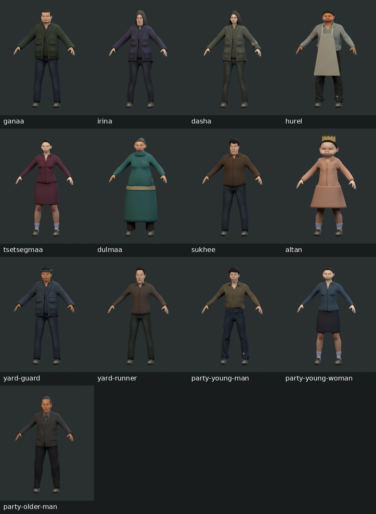
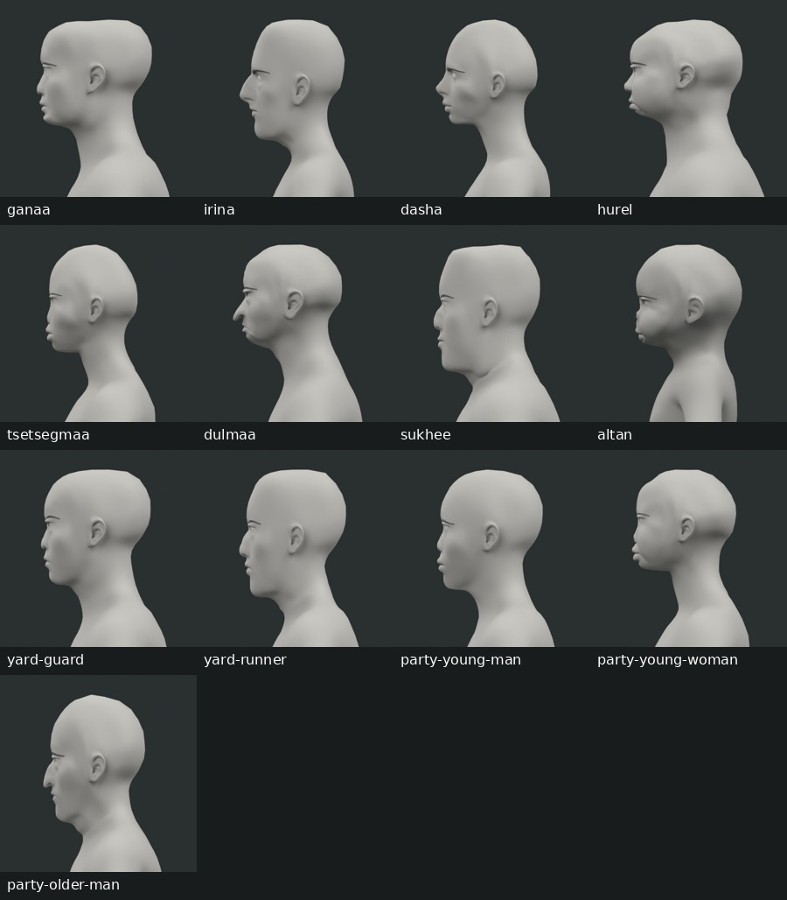

# Film character production master plan

> **Priority update — 28 October 2026:** [Character Master jobs](../../artifacts/character-master/production/JOBS.md) now sequence the accepted café test first. Keep the shared-pipeline and QA findings in this plan; the old HOUR 5 driver pilot is technical research and conflicts with the current Episode 1 passenger/silent-sheep staging. See [source authority](../../artifacts/character-master/production/SOURCES.md).
Created: 2026-10-27

Status: proposed production roadmap. Audit completed from the current working tree; character production has not been executed by this plan.

**Outcome:** an animator can load an approved character, already dressed and textured, pose and perform the required scene, and render it in the episode without repairing the asset first. The human selected **episode film first**. Start with Episode 1, then extend the proven pipeline to later episode casts.

## 1. Current development: what is actually ready

The project has a reusable character foundation, but the new characters are not yet ready for final episode shots. The largest remaining work is wardrobe deformation, facial performance, shot animation, and integration. Replacing the generator would discard useful work.

| Area | Evidence inspected | Current assessment |
| --- | --- | --- |
| Shared generator | `artifacts/character-master/scripts/build_character.py`, `dna.py`, `facial.py`, `appearance.py`, `DNA.md` | Keep pinned MPFB 2.0.18, MakeHuman source topology, skin UV convention, and shared 137-bone rig. Full authoring body has 19,158 vertices; 30 finger bones exist. |
| Five master presets | Presets, README, saved native/browser/QA reports, completed-verification section of `docs/superpowers/plans/2026-10-27-character-master-defaults.md` | Identity controls, expressions, talk checks, and neutral face QA already exist. Do not repeat the old plan's initial missing-feature findings as current defects. These are reusable examples, not five additional approved film roles. |
| Episode 1 DNA cast | 13 authoritative files in `artifacts/episode-1-cast/dna/` and their generated outputs | Each active DNA matches its generated `dna.json` and the fingerprint in its actor report. Ganaa is `approved`; the other 12 are `draft`. Approval is character design approval, not proof of shot readiness. |
| Identity QA | Saved `qa/report.json`, `diversity-report.json`, neutral lineup and all 13 profiles | Saved checks pass for all 13 and all 78 identity pairs. Closest parameter pair: Altan / party-young-woman, 0.086742 against 0.055 threshold. Faces differ visibly in the lineup; that does not replace human design review. |
| Native and GLB checks | Saved `native-report.json` and `browser-report.json`; actual GLB JSON inspected for all 13 | Saved reports pass. All 13 GLBs contain `Deformation_Check` and `Talk_Check`. These are technical exercises, not finished performances. Reports were not rerun during this planning audit. |
| Clothes | All 13 full-body previews; `build_actor.py` garment creation and binding | Every actor is dressed, but several repeat the same jacket, shirt and shoes. First fitting exists; production motion coverage does not. Deel/toddler skirt vertices use the `root` bone; apron vertices use `spine05`. These cannot establish usable sitting/running drape. |
| Face, hair and skin | Ganaa smile/blink images, all neutral profiles, full-body previews, review notes | Smile visibly narrows the eyes; brow shapes/hairlines remain uniform or harsh. Elder/toddler and close-up skin need deliberate art passes. The child still uses an adult source atlas. Existing art approval must be respected when correcting shared defects. |
| Film runtime | `src/character.js`, `src/scenes.js`, `src/sceneStages.js`, current cast tests | Film loads `assets/cast/<id>.glb`, not the DNA development outputs. `loadCharacter` immediately selects `idle`; the new exports have no `idle`. Existing expression names and skeleton conventions differ. Copying files over would break the loading/performance contract. |
| Existing Ganaa performance | Actual `assets/cast/ganaa.glb`, `assets/cast/cab.json`, pose/runtime tests | Legacy Ganaa has 25 joints and `idle/walk/wave/cough/hour-five`. DNA Ganaa has 137 joints and `EXP.*` shapes. His calibrated wheel/cheek contacts and 30-second performance must be rebuilt or retargeted and checked, not presumed portable. |
| Cast coverage | Current `assets/cast/roster.json`, DNA folder, film staging | Current roster: 54 entries, 52 visible roles and two voice roles. Docs still describe 48 visible roles. Only nine IDs overlap the 13 DNA actors; `yard-runner` and three party guest IDs need explicit casting/integration decisions. New uncommitted work includes four later cast actors. |
| Size and crowd cost | Actual GLB byte lengths and indexed triangle counts | Episode DNA assets are about 15.9–18.6 MB each in decimal units; all 13 total about 212 MiB. Exported geometry spans 44,376–69,594 indexed triangles per file, including exported modifier effects. Forty independent hero guests must not be assumed affordable. |
| Status/report accuracy | Episode README, QA page generator, actor reports | “All 13 draft” text is stale after Ganaa approval. Ganaa's actor report says `talkCheck: false`, although the actual GLB includes it; base-build metadata survives the later expression pass. Fix evidence reporting before trusting it as a release gate. |

The audit used existing stills, not newly rendered views. The profile and wardrobe boards below assemble those existing images without changing any character.

The existing matching-material front lineup is `artifacts/episode-1-cast/qa/lineup.png`; individual front, three-quarter, profile, and expression images remain under each actor's `qa/` directory.

### Limits of this audit

- Code, DNA, saved reports, GLB structure, images, and runtime consumers were inspected. No Blender rebuild, fresh native/browser suite, moving-cloth assessment, or film export was performed.
- Existing reports do not bind all results to an immutable generator revision and exported-file hashes. A matching DNA fingerprint is useful evidence, but does not certify the current code or every image.
- The working tree already contains film, scene, roster, asset, and test changes. Preserve them and establish an agreed baseline before production edits; do not reset them as cleanup.

## 2. Direction and boundaries

**Recommended approach:** finish the shared DNA pipeline, prove one dressed hero in the current film renderer, then build role-specific assets in small batches. This keeps the editable source and makes repeated fixes reusable.

Alternatives considered: polishing only the legacy cast gets quick blocking but leaves the new identity/authoring work unused; regenerating the whole cast with a new service discards the required shared topology and rig. Neither solves the present production gap as directly.

Decisions carried from the project: MakeHuman/MPFB stays the source; identity, age and additive expressions remain separate; signature traits remain individual; Ganaa's approved design stays approved; nobody else's DNA becomes approved automatically. Script facts and artistic choices stay distinguishable.

Planning proposals, still subject to creative review:

- Keep the existing restrained retro film direction. Establish the look with the actual shot camera, lights, grading and output resolution; avoid both accidental plastic realism and arbitrary PS2 polygon caps.
- Continue using Three.js/GLB and the existing film export path first. Native Blender files remain the authoring source. A switch to an offline Blender renderer would be a separate decision if the pilot demonstrates that the current renderer cannot meet the chosen look.
- Complete Episode 1's 13 development identities first. Later visible roles receive full DNA when their episode enters production. Voice-only roles do not require new bodies.
- Produce only outfits, props, facial controls and motions required by approved shots. Game controllers, a universal wardrobe editor, a huge random crowd generator, and blanket cloth simulation are outside this release.

## 3. What a production-ready character includes

Readiness is recorded **per approved asset version and intended shots**. A character ready to drive is not automatically ready for a chase or a lap interaction.

| Deliverable | Acceptance requirement |
| --- | --- |
| Identity and anatomy | Full authoritative DNA; canonical facts and artistic choices; individual face/body/age; 2–3 traits visible in clay front/profile views; explicit human identity approval. |
| Complete source | Full source topology and rig retained; editable skin, hair, clothes and accessories; source revisions reproducible; no unique work stranded only inside replaceable build outputs. |
| Dressed asset | Approved complete outfit, footwear and visible accessories; intentional seams, cuffs, collars, closures, thickness and fabric response; no missing skin exposed at required openings or poses. |
| Groom and surface | Hairline, eyebrows, lashes/eyelid edges, eyes, mouth interior, skin and hands survive actual close-ups. Skin/cloth/leather have distinct material response. Child and elder treatment is age appropriate. |
| Rig and performance | Shared deform skeleton preserved; usable animator controls; stable hands/feet/gaze; facial controls support required emotion and speech without losing identity; neutral recovers exactly. |
| Garment deformation | Required walk/run/sit/reach/contact poses have no visible penetration, tearing, floating trim, collapsing volume, or rigid skirt/apron behavior at delivery framing. |
| Story appearance | Required bandages, bite/line location, sweat, blood, dirt and damage have versioned continuity states and deterministic timing. A generic red multiplier is not finished makeup. |
| Film integration | Correct scale, origin, orientation, animation names and duration; deterministic seeking; required props and contacts; acceptable render cost and consistent Blender/film appearance. |
| Delivery and sign-off | Versioned source/GLB, textures, source credits, QA boards, motion movie, native/runtime evidence, known limits, and human approval of the rendered shot. No open visible blocker. |

## 4. Sequenced production work

### Phase 0 — Establish a trustworthy baseline and shot inventory

Lead: technical artist, with director review. This is the first execution package.

1. Reconcile current roster, aliases, actual scene usage, DNA IDs, current asset versions and approval records. Keep canonical script identity separate from background casting instances. Preserve existing Ganaa approval and candidate history.
2. Create a compact production matrix in `docs/production/character-readiness.md` (proposed). One row per actor/outfit/story state, with required shots, source DNA, published asset version, design approval, fit/performance/integration status, blockers and evidence links. Derive claims from artifacts; avoid another undocumented “ready” flag.
3. Read the full approved Episode 1 dialogue and shot staging before finalizing the costume/prop/action breakdown. Use `docs/production/dialogue-master.md` for dialogue and `series-bible.md` for context; log contradictions instead of inventing continuity.
4. Fix generated report/status accuracy in the shared reporting points. Record DNA hash, generator revision or source digest, GLB hash, relevant source-asset hashes, tool version, check date and approval evidence. Human approval and technical pass remain separate.
5. Preserve a before-change reference of the current HOUR 5 shots and cab calibration. Choose a versioned publication layout next to the current cast assets; keep legacy fallback until the pilot is accepted.

**Exit evidence:** reconciled actor/shot matrix; no unexplained ID or approval mismatch; accurate clip metadata; reproducible baseline references. Do not start a mass rebuild to resolve inventory errors.

### Phase 1 — Prove the new skeleton loads in a real film shot

Lead: technical artist. Do this early, before a large costume art pass.

1. Publish a separate candidate DNA Ganaa without overwriting legacy `assets/cast/ganaa.glb`. Add a small, explicit asset selection at the current loading boundary; maintain existing callers and legacy actors.
2. Define the compatibility contract once: centimetres/metres versus existing scene units, floor and seated origins, forward/up axes, root motion ownership, clip naming, semantic expression mapping and time ownership. Test a measured standing actor and the seated cab before choosing scale conversions.
3. Resolve `idle` startup deliberately; a development check clip must not silently stand in for a finished performance. For the pilot, provide an intentional idle/rest path while retaining the current API used by scenes.
4. Verify a short body-and-face sample in the existing renderer. Confirm textures, normal maps, transparency, separate facial parts and expressions survive export; inspect close face and hands plus a full-body frame.
5. Keep only one pose owner per frame. The film timeline supplies absolute time; baked animation and any explicit shot-state layers must return identical results after arbitrary seeking.

Likely touchpoints: `src/character.js`, `src/cast.js`, `assets/cast/asset-report.json`, `src/scenes.js`, `src/sceneStages.js`, `tests/cast-runtime.test.mjs`, `tests/cast-assets.test.mjs`, and `tests/cast-pose.test.mjs`. Reuse the existing GLB loading/cache/disposal and clip sampling patterns.

**Exit evidence:** candidate character loads and seeks correctly in the film; old cast still loads; scale/material parity documented. This is a technical proof, not approval of final performance.

### Phase 2 — Finish shared face, materials and the required wardrobe

Leads: character artist and technical artist; director approves appearance.

#### Shared face and surface work

- Correct smile/lid interaction in the shared expression mapping; validate blink closure against fitted eyes without swelling or eyeball penetration. Check smile, blink, speech and combinations across toddler, adult and elder faces.
- Give brows believable density/edges and hair a convincing silhouette/hairline at shot distance. Keep individual face identities intact; hair changes do not resolve duplicate faces.
- Improve child skin through a dedicated age-appropriate paint pass on the shared UVs. Review elder skin at delivery size. Do not solve age by adding the same wrinkle meshes to everyone.
- Review eyes, teeth, tongue, lip closure, neck/hand seams, roughness, pores and stubble in studio and scene light. Move detail into texture/normal layers when it looks like floating geometry; keep editable source layers.
- Extend facial controls only for performances that need them: useful jaw/lip shapes, brow emotion, gaze and independent blinks as required. The existing A/E/O/M set is a starting point; it is not a complete Mongolian/Russian speech solution.

#### Clothing source and fitting rules

- Start with existing fitted assets; tailor silhouettes that fail role, period or shot needs. New garments become shared editable source assets with fitting/coverage metadata, rather than ad hoc edits to a generated actor.
- Use standard MHCLO fitting for reusable garments. Keep custom garment/texture authoring in a sibling source area outside per-actor output folders; register asset IDs through the existing library/recipe mechanism.
- Replace single-bone attachment for deforming skirts, apron, sash and relevant trim with meaningful fitted weights and only the correctives the shots need. Rigid head props can remain rigid.
- Establish layer order and clearance for shirt/jacket/body, trousers/boots, sleeves/bandage and hair/cap. Test shoulders, elbows, waist, hips and knees through full required motion, not only rest pose.
- Recompute covered-skin masks per outfit. The complete body stays in authoring; the masked runtime body cannot support arbitrary garment removal. Supply an appropriate regenerated body variant when a scene exposes a previously covered region.
- Add fabric grain, seams and wear at visible scale; do not bake strong studio lighting into albedo. Avoid identical noise/wear on every coat and every pair of shoes.
- Prefer skinning and a few fitted correctives. Use cloth simulation only where the chosen shot demands motion they cannot provide. Blender caches do not automatically become GLB performance; prove the supported baked bone/morph result in the actual renderer before committing to that route.

Shared touchpoints: `artifacts/character-master/scripts/appearance.py`, `facial.py`, `dna/expressions.json`, `dna/library.json`, source garment files under `assets/sources/`, and `artifacts/episode-1-cast/scripts/build_actor.py`. Extend existing validators/checks when the schema or export contract changes; do not build a second character generator.

#### Episode 1 costume and movement matrix

These are proposed finishing briefs derived from current casting and source notes. Exact construction, colors and wear remain artistic choices; confirm shot-required props against the dialogue breakdown.

| Actor(s) | Finish the existing costume direction | Required fit/performance proof |
| --- | --- | --- |
| Ganaa | Work jacket, believable shirt/trouser/footwear, readable wrist bandage and progressive makeup; preserve approved identity | Driving seat, wheel grips, braking, slap/cheek contact, eating and party/lap contact when those shots enter production; sleeves must not conceal the required story insert. |
| Irina | Muted practical coat, distinct from Ganaa's work jacket; retained bob; satchel/tape/recorder interfaces where used | Speaking, looking, reaching and handing over the bag without hair/collar or wrist penetration. |
| Dasha | Travel coat fitted to her silhouette, trousers/footwear, left forearm scarf; restrained healthy/unwell/fed continuity | Sitting/passenger pose, eating, turn, sprint/lunge; scarf follows forearm and remains readable. |
| Hurel | Work shirt, trousers and a flexible apron with fitted straps and intentional wear | Service reach, forward bend, turn and required attack/fall; apron must not behave as a rigid torso plate. |
| Tsetsegmaa | Period party outfit with finished waist/hem, convincing hair and footwear | Walking, leaning toward Ganaa, touching/checking him and required interaction with Altan. |
| Dulmaa | Properly constructed everyday deel, overlap/collar/sash and boots | Walk, sit, bend and reach; hem and sash deform with body and clear the legs. |
| Sukhee | Individual everyday party clothes; finish the intended stripe/shirt direction consistently with the source | Sitting, eating, talking and turning; collar, stomach/waist and sleeves hold up. |
| Altan | Child-specific birthday garment construction, suitable footwear, paper crown; age-appropriate skin | Walk, climb onto lap, sit, reach and look up; skirt clears thighs and adult body; crown stays on the head. |
| Yard guard | Practical guard jacket/cap and footwear; handheld flashlight/keys if visible | Approach door, reach, recoil, attack response; headwear and sleeves stay fitted. |
| Yard runner | Worn work clothes with deliberate infected-state wear | Sprint, lunge and contact at actual shot speed; shoulder/hip silhouette remains sound. |
| Three guest identities | Distinct, modest party silhouettes and footwear; reusable source outfits with fit checks | Sit, eat, converse and react. Background reuse must not read as adjacent identical people. |

**Exit evidence:** approved dressed turnarounds and close-ups; clay identity/profile comparison; deformation movies for the wardrobe classes. No actor is promoted merely because the build succeeds.

### Phase 3 — Finish Ganaa's HOUR 5 performance and release the pilot

Leads: animator and technical artist; director approves the rendered result.

1. Add an animator control layer over the shared deform rig as needed for hands, feet, gaze and contacts; keep export bone names stable. Do not rename the deform skeleton to imitate the legacy one.
2. Rebuild or retarget the legacy performance onto DNA Ganaa. Treat old timing as reference, then recalibrate body position, wrist/cheek markers and steering contacts to the new anatomy using `assets/cast/cab.json`.
3. Preserve the established 30-second timing and existing contact checks as regression expectations: both palms at the wheel where intended, right hand to cheek at 22.15 seconds, then return. Set numeric tolerances in calibrated scene units; do not loosen tests to hide a missed contact.
4. Author readable breathing, cough/tremor, gaze, emotional holds, hand/finger pose and jacket compression. Bake the final deform skeleton and facial performance for playback; export no dependency on Blender-only constraints.
5. Finish healthy/HOUR 5/turning continuity on exposed skin and wardrobe. Agree the exact bite/line side and shot timing from the approved edit before authoring. Keep appearance states separate from facial identity.
6. Use an approved recorded or temporary dialogue track for timing. Final speech approval requires the final voice and a corresponding lip-sync pass; silence and approximate mouth motion stay explicitly provisional. Check Mongolian/Russian articulation by the actual lines, not a generic viseme demo.
7. Render through the current film export at its existing 1280×720, 24 fps baseline. Compare native and runtime close-ups and check compression, grading, eye highlights, hair edges and garment motion at final size. Any delivery-resolution change is a separate production decision.

**Exit evidence:** accepted full 30-second dressed-character film render, sound/speech status stated, deterministic seek/contact checks, and exact published asset hashes. Ganaa becomes **ready for HOUR 5** only after this gate; other shots remain separate.

### Phase 4 — Prove child and action cases, then finish Episode 1

1. **Altan + Tsetsegmaa + Ganaa:** short birthday interaction covering lap/climb/reach and seated skirt behavior. This proves pediatric proportions, layered contacts and the weak garment class before copying it to more characters.
2. **Dasha + yard runner + guard:** short action tests for sitting-to-motion, running, lunging, recoil and coat/scarf behavior. Use only the actions their approved shots need; do not invent new story beats.
3. **Dulmaa + Hurel:** deel and apron movement tests. Their single-bone garment shortcuts must be replaced before approving required moving shots.
4. **Irina + Sukhee + three guests:** finish the remaining speaking/reaction assets and their shot-specific poses. Create reusable idle/walk/cough/sit assets only where they reduce actual shot work; body proportions still require contact correction.
5. Establish a background party/crowd strategy from the real camera views. Use lightweight representations for distant figures and hero rigs for visible performances. Reuse source garments/materials and stagger motion; avoid loading forty unique 16–19 MB hero files by default.
6. Measure the densest party and chase frames on the production workstation: peak memory, draw calls, texture usage, cold scene load, frame render time and export failures. Set a supported envelope from measurements. Offline frame capture must produce all frames reliably; interactive preview may use a reduced display quality.
7. Replace placeholder people only as approved character versions pass. Verify character positions against tables, doors, cab seats and other actors after every scale change. Remove procedural figure stand-ins shot by shot, not through a blind roster-wide swap.

**Exit evidence:** all Episode 1 on-screen roles covered in the shot matrix; approved wardrobe and story states; every required shot has a compatible published character version; accepted motion/continuity reels and a successful worst-case scene export.

### Phase 5 — Package, publish and expand by episode

Lead: technical artist/production owner.

- Publish immutable character versions with explicit source lineage. Reuse `assets/cast/asset-report.json` where appropriate; record DNA/source revision, outfit and state IDs, supported clips/morphs, source and export hashes, provenance, check evidence and shot approval scope. Separate multiple asset families explicitly.
- Deliver the complete editable `.blend`, authoritative DNA, shared custom garment/material sources, packed or accompanying textures, runtime GLB, performance clips, thumbnail/turnaround, expression sheet, deformation reel and usage notes. Optional interchange formats are added only for a named consumer.
- Reopen the packaged native source independently and load the published GLB through the film path. Confirm no missing external textures/assets and no export of hidden authoring/control geometry. Preserve full topology in the authoring file.
- Update `artifacts/character-master/DNA.md`, the episode README, `docs/character-production.md` and `docs/cast.md` so generation, approved assets, runtime loading and known limits agree. Preserve historical candidates as history, not current release choices.
- Once Episode 1 gates pass, schedule later roles from the current shot/episode priority. Apply the same full DNA and approval rules to new adults, teens, children and newborns. The current toddler baseline does not establish a validated infant anatomy/rig or swaddle solution.
- Keep legacy assets available until every scene using them has migrated and its output has passed review. Retire them through a separate reviewed cleanup.

**Exit evidence:** an animator can reproduce and render the approved shot from its published package; later episodes can reuse the verified source pipeline without repairing Episode 1's underlying controls again.

## 5. Verification and approval gates

Existing checks are the starting point. Extend their actual coverage rather than equating more report files with better evidence.

| Gate | Required verification | Pass condition |
| --- | --- | --- |
| Source and identity | `test_dna.py`, `test_config.py`, episode `test_recipes.py`; DNA fingerprints; matching-material lineup, profiles and distinctiveness report | Valid full DNA; canonical facts preserved; all changed identities reviewed; exact neutral recovery; no unnoticed duplicate faces. |
| Face and materials | Native and browser checks; expression sheet plus smile/blink/speech combinations; studio/day/night and final shot frames | Eyes close cleanly, mouth interior stays contained, details follow deformation, no detached features or visible seams; director accepts the final appearance. |
| Dressed deformation | Add required pose sampling to native/browser QA and render motion reels per wardrobe class | Normalized valid weights and finite geometry; no visible clipping/collapse in required motion; manual contact/fabric review remains mandatory. |
| Film compatibility | Extend `tests/cast-runtime.test.mjs`, `cast-assets.test.mjs`, `cast-pose.test.mjs`, `scenes.test.mjs` as consumers change | Correct asset/version selection and scale; missing required clips/states fail clearly; legacy actors still load; actor instances have independent pose/material state; disposal remains correct. |
| Performance and continuity | Repeated and out-of-order seeking, first/last frame, all cuts and contact moments; facial neutral restore; state reset | Same scene time gives the same pose, makeup, prop visibility and contacts regardless of seek history. Final voice drives approved lip sync. |
| Delivery | Existing build/test commands plus real browser film export and packaged-source reopening | All required checks pass on the published files; correct frame count, frame rate and duration; no missing resources, dropped frames or visible regressions; final human sign-off recorded. |

Execution commands already documented in this repository include the master config/DNA tests, episode recipe tests, episode `qa_all.py`, `check_native.py`, and `check_browser.mjs`; browser checks need the local preview server and installed Chromium/Brave. Project integration uses `npm run check`. Film delivery uses `scripts/render-film.mjs` with its documented server and Playwright prerequisites. Run them during execution against the selected artifact versions; this audit does not claim they pass now.

Automated movement tests cannot judge good fabric, natural acting or a believable face. Show the human the clay lineup **and profiles**, dressed turnarounds, expression sheet, motion reel and final shot. Identify visible failures and keep unapproved DNA draft. Do not revoke Ganaa's existing identity approval merely because his first shot is unfinished.

## 6. Resources, order and completion

| Work package | People/skills required | Dependency and completion marker |
| --- | --- | --- |
| Baseline and early integration | Technical artist; director for scope | Phase 0, then Phase 1; candidate loads correctly in the existing film. |
| Shared finishing | Character/wardrobe artist plus technical artist | Early integration established; shared face and garment classes pass their motion sheets. |
| Ganaa pilot | Animator, technical artist, director; voice performance for final dialogue | Shared finishing for Ganaa; accepted HOUR 5 render. |
| Child/action/remaining cast | Same roles, working in small actor batches | Pilot accepted; child and action cases pass before broad rollout. |
| Episode package | Production owner/technical artist and director | All assigned shots pass; versioned packages and evidence delivered. |

One person may fill multiple roles. No calendar promise is justified before the dressed Ganaa pilot establishes actual art/revision and render cost. Measure that package, then estimate remaining actors by wardrobe, animation and contact complexity; Altan's interaction or a sprinting coat should not be estimated like a background guest.

**Recommended next execution:** Phase 0 and the small Phase 1 Ganaa integration proof. Then finish his face/jacket/performance together through one accepted shot. Do not spend the next batch on generating more character identities while existing costumes and performances remain unproven.

The character release is complete when all intended Episode 1 shots use approved versions, wardrobe and story states survive the required motion, the actual film exports reliably, and another animator can open the package and continue without asset repair. This does not imply that the full 15-episode film, final sound mix, or game release has been produced.

## 7. Sources and external checks

Primary local sources: `AGENTS.md`; `artifacts/character-master/DNA.md` and `README.md`; the current generator, presets and libraries; `artifacts/episode-1-cast/README.md`, active DNA, actual GLBs, reports, QA images and `ganaa-production-review.md`; the production dialogue/bible; current roster/runtime/staging; existing cast and film tests. The newer Ganaa approval record takes precedence over stale generic “all drafts” prose.

The official [MakeHuman asset-pack catalogue](https://static.makehumancommunity.org/assets/assetpacks.html) lists CC0 system assets, CC0 clothing/brow/hair options and functional viseme packs, alongside separately licensed additions. Reuse or evaluate these before authoring replacements; this plan has not downloaded, tested for fit, or approved any new pack. Check each selected asset's recorded terms and source manifest rather than treating the whole catalogue as CC0.

Exporter decisions above are grounded in the local build/export code, actual GLB contents, and current film consumers. Blender manual pages could not be retrieved during this audit; no new version-specific exporter behavior is assumed. Verify the exact baked animation and material behavior with the pinned local Blender/exporter and the film's actual loader during the pilot.
